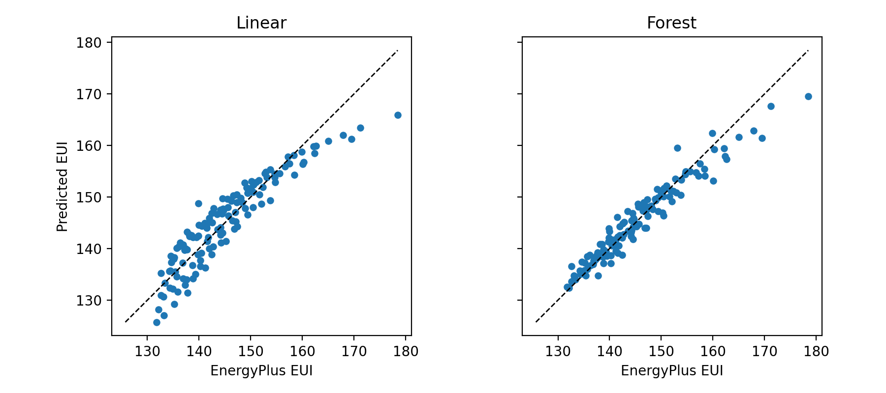
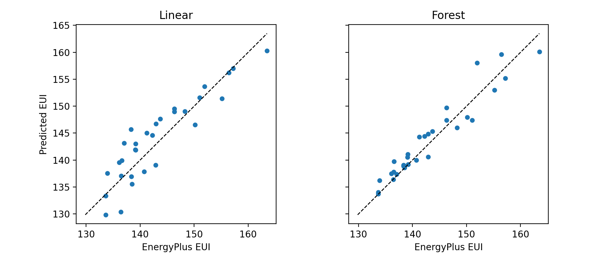

# Figures

# Façade EUI Prediction Results

The [simulation dataset](../../Data/Final%20160%20Result%20Data.xlsx) contains 160 façade configurations for the Singapore reference office. EnergyPlus simulations produced annual energy use intensities (EUIs) ranging from 131.81 to 178.46 kWh/(m²·year).

The figures compare EUI predicted by linear regression and random forest with EUI simulated by EnergyPlus. In both plots, the dashed line marks exact agreement between prediction and simulation.

## Figure 1. Model selection on 130 development cases

In five-fold cross-validation, the random forest achieved a lower mean absolute error than linear regression (1.78 versus 2.87 kWh/(m²·year)) and was selected as the surrogate model for façade screening.

## Figure 2. Performance on 30 held-out test cases

| Model | MAE [kWh/(m²·year)] | RMSE [kWh/(m²·year)] | R² |
|---|---:|---:|---:|
| Linear regression | 2.97 | 3.42 | 0.802 |
| Random forest | 1.83 | 2.27 | 0.913 |

On the held-out cases, the random forest reduced mean absolute error by approximately 38% relative to linear regression.
